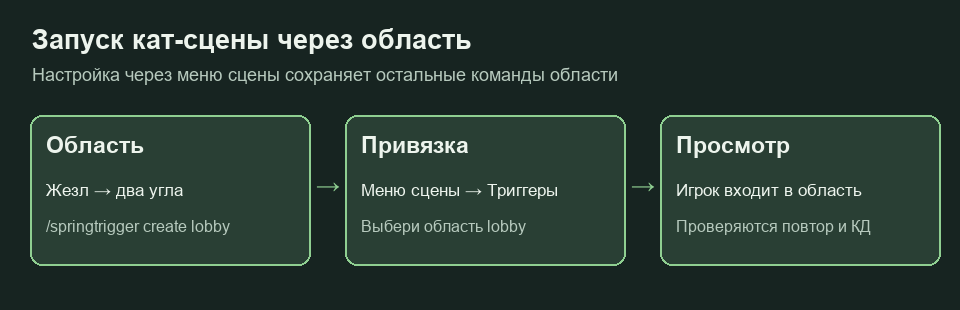

# Кат-сцены

Кат-сцены создаются через меню **`/springrp cutscene menu`**. Нужно право `springrp.cutscene.admin`. Редактор, камеры и актёры работают через серверные плагины и Denizen. Экранные эффекты требуют актуального SpringVisuals, озвучка — Plasmo Voice.


Работа кат-сцен на основном сервере подтверждена владельцем **21 октября 2026 года**. Ниже описан актуальный редактор линии 26.3.


## Создание первой сцены

1. Открой меню и создай сцену с коротким уникальным ID латиницей.
2. Выбери точки камеры или запись движения. Запись по умолчанию длится 30 секунд; `/springrp cutscene stop` завершает её раньше.
3. Встань в нужную позицию и направь взгляд. В «Точках камеры» добавь точку из текущего положения.
4. Перейди в следующую позицию, добавь точку и укажи время перелёта **к ней**, затем паузу после прибытия.
5. Запусти предпросмотр и проверь маршрут до подключения триггера.

Для первой точки используется только пауза. У следующих выбирается переход:

| Режим | Поведение |
| --- | --- |
| `linear` | Равномерный перелёт |
| `smooth` | Плавные разгон и торможение |
| `cut` | Мгновенная смена кадра |

Жезл редактора: **ПКМ по блоку** добавляет точку с текущим положением и взглядом камеры; **Shift + ПКМ** открывает меню. «Показать маршрут» рисует частицы только редактору.

## Актёры и события

В «Актёрах и ролях» создай роль в своей позиции, задай имя, скопируй скин и экипировку игрока в сети. В «Событиях по времени» добавляй надписи, звуки, экранные эффекты, озвучку, позы, взмахи рукой и перемещения.

Время события — секунды от начала сцены. Меню выводит формат ввода в чат. Например, `2 | Привет!` задаёт надпись на второй секунде, `3 | 1 | crouching` — позу первой роли на третьей секунде.

Событие перемещения актёра сохраняет позицию администратора и **мгновенно** переносит туда актёра. Для плавного движения камеры используй точки камеры.

## Предпросмотр

`/springrp cutscene controls` открывает управление паузой, переходом ко времени и скоростью. Команды:

```text
/springrp cutscene pause
/springrp cutscene resume
/springrp cutscene seek 5
/springrp cutscene speed 0.5
```

Они управляют только предпросмотром. Доступны скорости 0.25×, 0.5×, 1× и 2×. Shift завершает предпросмотр.

Можно сделать копию сцены, поменять отображаемое имя и отменить последнее изменение. ID сцены при переименовании сохраняется, поэтому привязки продолжают работать. Если сцену одновременно изменил другой администратор, обнови меню и повтори действие.

## Запуск через область



1. Создай область через [SpringTriggers](triggery.md).
2. Открой сцену → «Триггеры» → нажми нужную область. Требуется также `springtrigger.admin`.
3. Настрой повтор (`always` или `once`), персональный КД и разрешение пропуска.
4. Выйди из области и зайди снова для проверки.

Редактор добавляет команду входа `springrp cutscene trigger <scene_id> {player}`. Повторное нажатие снимает именно её, сохраняя другие действия области.

Одноразовая сцена считается просмотренной после **успешного завершения**. Пропуск не блокирует следующую попытку. Ручной запуск `/springrp cutscene play <id> [игрок]` и предпросмотр обходят историю триггеров. Игроку, который уже записывает или смотрит сцену, второй просмотр не запускается.

Запуск с кнопки настраивается через [панель](paneli.md).

## Ограничения

Сцена — до пяти минут, 300 точек, восьми актёров, 128 событий и 48 чанков камеры. При перемотке аудиофайл не перематывается, а прошедшие одноразовые события заново не проигрываются. Сохранённые позиции и позы актёров восстанавливаются.

После завершения или отмены должны восстановиться положение, игровой режим, полёт и видимость зрителя, а временные камера и актёры — удалиться. Если сценарий ведёт себя иначе, сохрани ID сцены, шаг воспроизведения и серверный лог.
