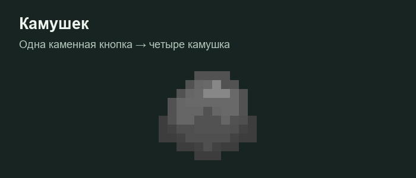

# Камушки и броски

Положи **одну каменную кнопку** в сетку крафта — получится **четыре камушка**. Камушек является отдельным предметом и не ставится как кнопка.

## Как бросать

Возьми камушек, зажми **ПКМ**, чтобы накопить силу, и отпусти. По умолчанию полный заряд занимает одну секунду и увеличивает силу до двух раз. Заряд отображается отдельной полосой; опыт игрока для этого не используется.

Чтобы пустить камушек по воде, бросай под небольшим углом. Есть **25% шанс**, что он сразу утонет. В остальных случаях ему случайно назначается от двух до четырёх возможных отскоков; угол и скорость могут закончить полёт раньше. Каждый отскок короче и ниже предыдущего. Число отскоков заранее не показывается.

Камушек наносит **1 HP** урона, кирпич — **2 HP**. Броски могут разбивать стекло с учётом установленных защит территории. Параметры силы настраиваются администрацией.
