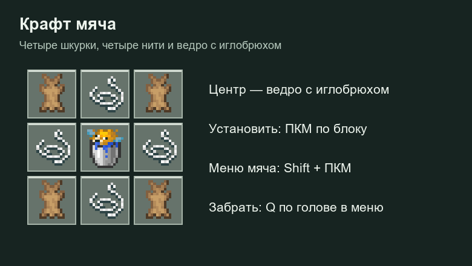

# Мячи

## Крафт

| Ряд | Слева | Центр | Справа |
| --- | --- | --- | --- |
| Верхний | Кроличья шкурка | Нить | Кроличья шкурка |
| Средний | Нить | **Ведро с иглобрюхом** | Нить |
| Нижний | Кроличья шкурка | Нить | Кроличья шкурка |

Нужны четыре шкурки, четыре нити и одно ведро с иглобрюхом. Обычное ведро воды не подходит.

## Установка и подбор

**ПКМ предметом мяча** устанавливает его в мире. Чтобы забрать мяч, открой его настройки через **Shift + ПКМ** и нажми **Q по центральной голове в меню**. Q рядом с мячом само по себе не подбирает его.

В описании предмета сохраняются характеристики. Установленные мячи сохраняются после перезапуска и плавают на воде.

## Управление

| Действие | Волейбольный мяч | Футбольный мяч |
| --- | --- | --- |
| ЛКМ / взмах | Удар; бег и прыжок влияют на бросок | Удар ногой |
| ПКМ | Подбросить вверх | Подброс вверх недоступен |
| Контакт с игроком | Физическое взаимодействие | Мяч катится от контакта |
| Shift | Сам по себе не подбрасывает | Усиливает удар |
| Shift + ПКМ | Настройки | Настройки |

## Накачка и внешний вид

**ПКМ зарядом ветра** добавляет 10% накачки. Заряд расходуется, только если значение действительно увеличилось. В меню **ЛКМ по центральной голове** выпускает 10%, **ПКМ** переключает тип мяча.

При накачке мяч увеличивается, при откачке уменьшается. Диапазон размера — 70–130%, обычное значение накачки — 50%. Накачка и тип влияют на поведение мяча.

В меню доступны головы мячей и избранное; ПКМ по варианту добавляет его в избранное. Свой внешний вид удобнее задать через кнопку ввода ника в меню: используется скин, включая доступный через SkinsRestorer.

Административные команды `/ball menu`, `/ball skin <ник>`, `/ball skin <HTTPS-ссылка>` и `/ball skin held` требуют `springrp.ball.test` (по умолчанию OP). Обычные игроки открывают настройки через Shift + ПКМ по самому мячу.
