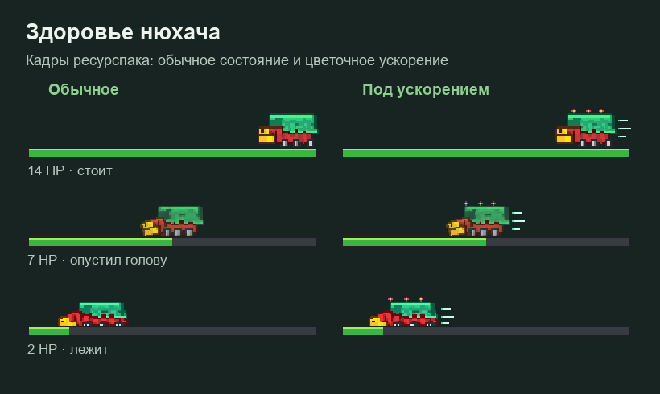

# Нюхачи и сокровища

## Приручение и езда

Корми дикого нюхача яблоками. По умолчанию шанс приручения — **5% за яблоко**: сердечки означают успех, дым — неудачу. У приручённого нюхача сохраняется владелец.

Установи седло на своего нюхача и нажми **ПКМ пустой рукой**, чтобы сесть. Доступно два места: первый всадник управляет через WASD и направление взгляда, второй едет пассажиром. `Shift` позволяет спешиться. Нюхач переступает блок высотой в один блок; Ctrl не включает отдельный спринт, прыжок всадника не используется.

Чтобы снять седло со свободного нюхача, нажми **Shift + ПКМ ножницами**.

## Здоровье и лечение

У нюхача **14 HP — семь сердец**. Полоска меняется с шагом **0,5 HP** и имеет три состояния рисунка.

**ПКМ факельником или кувшинником** восстанавливает **2 HP — одно сердце**. При полном здоровье цветок не расходуется.

[Цветочное зелье](cvetochnoe-zele.md) ускоряет нюхача на **25% на пять минут**. Во время действия меняется оформление цветов на полоске и появляется таймер под ней.

## Поиск клада

1. Сядь на приручённого нюхача и дай ему яблоко.
2. Следуй по появляющимся точкам на поверхности. Путь состоит из 5–10 этапов.
3. В конце нюхач выкопает сундук **перед собой**. Открой его ПКМ.

Поиск требует подходящей поверхности в обычном мире. После появления сундука начинается **25-минутный КД самого нюхача**. Смена всадника этот КД не сбрасывает.

Над сундуком указаны его тема и редкость. По умолчанию он существует до десяти минут и удаляется, когда его опустошают. Его содержимое общее для допущенной группы.

## Темы и редкость

Есть **девять тем**: обычный, морской, книжный, оружейный, сокровищница, варденовский, адский, эндовский и винный. У каждой пять редкостей — всего **45 таблиц**.

| Редкость | Предел уровня чар | Оставшаяся прочность | Выборок лута |
| --- | --- | --- | --- |
| Обычная | I | 20–50% | 3 |
| Необычная | II | 40–70% | 3 |
| Редкая | III | 60–85% | 4 |
| Эпическая | IV | 80–100% | 4 |
| Легендарная | V | 100% | 5 |

Чары подбираются совместимыми с предметом и друг с другом. Обычный подбор учитывает собственный максимум чар; явно заданные уровни на книгах могут быть выше ванильных, но не выше предела редкости. Оружие и броня выдаются по одному. Выборка может повторить предмет; это не гарантированное число разных заполненных ячеек.

| Яблоко | Обычная | Необычная | Редкая | Эпическая | Легендарная |
| --- | --- | --- | --- | --- | --- |
| Обычное | 65% | 27% | 8% | — | — |
| Золотое | — | 30% | 45% | 21% | 4% |
| Зачарованное золотое | — | — | 35% | 45% | 20% |

Точный состав таблиц администрация смотрит в [тестовом стенде](../../admin/test-sundukov.md). Название «винный» обозначает тему лута: оно не гарантирует функциональную винную бочку или уникальное вино, если такие предметы пока не подключены.
