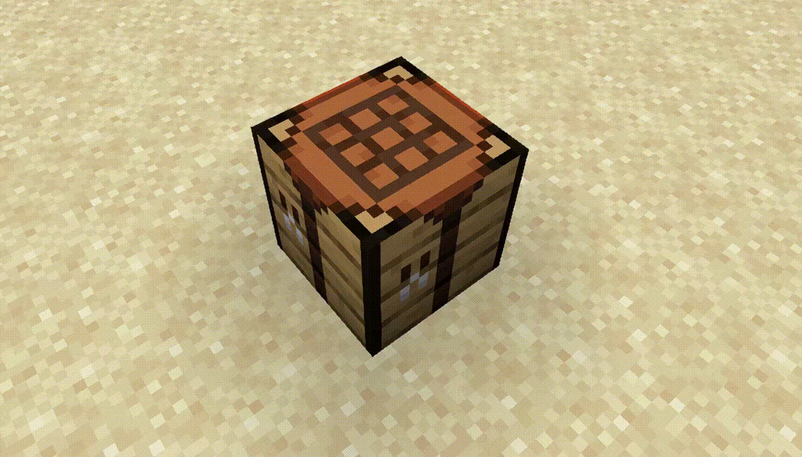

# Предметы на верстаке

Когда игрок раскладывает рецепт в верстаке, окружающие видят предметы прямо на его поверхности — по сетке 3×3 и в правильной ориентации относительно мастера.

<figure><figcaption></figcaption></figure>

Модели видны окружающим, но скрыты от самого игрока с открытым верстаком. Это визуальная копия сетки: подобрать её нельзя. При закрытии окна предметы на поверхности исчезают.
