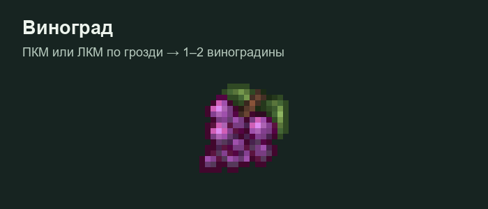

# Виноград и вино

## Где искать виноград

Гроздья появляются под естественной листвой дуба и берёзы в подходящих биомах равнин, лугов и лесов. Подходит также поставленная игроком листва азалии и цветущей азалии.

Появление случайное, периодически проверяется рядом с игроками и ограничено числом гроздей в чанке. Гроздь не обязана появляться сразу после установки листвы.

Нажми **ПКМ или ЛКМ по грозди**: получишь **1–2 виноградины**, а собранная гроздь исчезнет. Одинаковые виноградины должны складываться в обычные стаки без потери лишних предметов.

Если старая гроздь осталась после сбора или выглядит как неподбираемый предмет, сообщи координаты администрации. Это может быть объект старой версии; новые грозди обрабатываются отдельно.

## Статус виноделия


Полноценный рецепт вина **из винограда** пока не подтверждён текущим обработчиком: прототип котла принимает ломтики арбуза. Наличие винных предметов в ресурспаке не означает готовую производственную цепочку. Прежняя винная бочка с отдельным GUI в активной реализации не используется.


Для доступных сейчас проверяемых рецептов котла смотри [напитки](napitki.md). Администрации: диагностика и ручное выращивание описаны в [инструментах мира](../../admin/instrumenty-mira.md).
