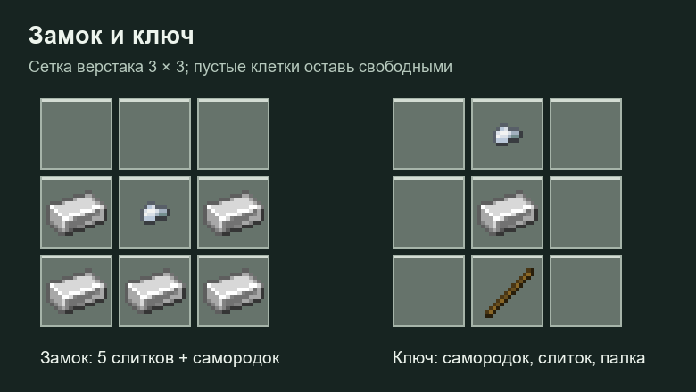
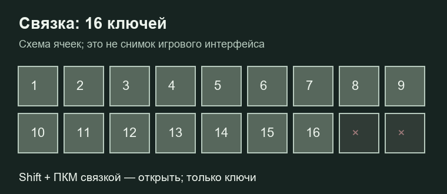

# Замки, ключи и связка

Замки устанавливаются на бочки, обычные сундуки и сундуки-ловушки, медные сундуки, железные и медные двери и люки. Поддерживаются окисленные и вощёные медные варианты. Деревянные двери и люки замок не поддерживают.

## Крафты

Замок: пять железных слитков и один железный самородок.

| Ряд | Слева | Центр | Справа |
| --- | --- | --- | --- |
| Верхний | — | — | — |
| Средний | Железный слиток | Железный самородок | Железный слиток |
| Нижний | Железный слиток | Железный слиток | Железный слиток |

Ключ:

| Ряд | Слева | Центр | Справа |
| --- | --- | --- | --- |
| Верхний | — | Железный самородок | — |
| Средний | — | Железный слиток | — |
| Нижний | — | Палка | — |

## Установка и доступ

1. Возьми замок в основную руку и нажми **Shift + ПКМ** по поддерживаемому блоку.
2. Владелец замка нажимает по нему **ПКМ обычным ключом**, чтобы привязать ключ.
3. Подходящий ключ даёт доступ любому его держателю. Его достаточно иметь в инвентаре или связке — держать в руке для открытия не обязательно.

Привязанный ключ нельзя одновременно привязать к другому замку. На запертой металлической двери или люке ПКМ с доступным ключом переключает открытие; редстоун замок не обходит. Железные двери и люки **без замка** можно открывать ПКМ и обычным редстоуном.

## Связка ключей

В связке **16 ячеек только для ключей**. Возьми её в руку и нажми **Shift + ПКМ по обычному блоку**, чтобы открыть. Две оставшиеся ячейки стандартного окна недоступны. Для открытия меню лучше смотреть в сторону от замка: тем же жестом начинается снятие замка.

Ключи внутри связки участвуют в проверке доступа автоматически. Способ получения связки уточни у администрации: обычный рецепт в текущих исходниках не зарегистрирован.

## Снятие и разрушение

Чтобы снять замок, держи подходящий ключ или связку с ним в основной руке и **удерживай Shift + ПКМ три секунды**. Замок возвращается предметом, соответствующая привязка снимается.

Для взлома закрытого блока нужно непрерывно ломать его **60 секунд**; отпускание ЛКМ прерывает попытку. Замок не следует считать защитой от любых способов разрушения мира.

После разрушения блока его ключи становятся обычными непривязанными ключами. Для предметов у отсутствующих игроков обновление выполняется при следующей доступности. Отдельного «ненужного ключа» и его перекрафта больше нет.

При успешном сносе блока администратором в творческом режиме замок удаляется автоматически. Если ломание отменено защитой, замок должен сохраниться.
