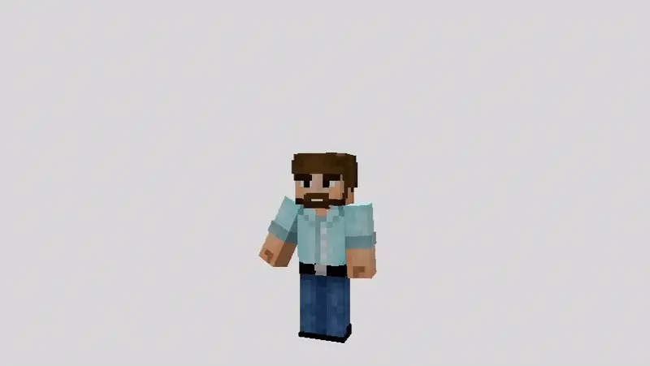

# Клиентская сборка

Рекомендуется **SpringRP Launcher**, который можно получить у администрации: он получает актуальный состав сборки. [Релизы на GitHub](https://github.com/SpringRP/SpringRP-base/releases) доступны участникам закрытого репозитория. Базовая версия — **Minecraft Java 26.3**, **Java 25**, **Fabric Loader 0.19.5**.

## Что нужно для механик

| Компонент | Для чего нужен |
| --- | --- |
| Серверный ресурспак | Модели предметов, сундуков, панелей и интерфейсы. Прими загрузку при входе |
| SpringVisuals / SpringRP Posters | Текст и оформление анимированных плакатов, экранные и пространственные эффекты проекта |
| Clientizen | Клавиши поз `[` и `]` |
| Plasmo Voice | Голосовой чат, аудиозаписи и кастомные пластинки |
| Emotecraft | Анимации персонажа и колесо эмоций |
| Punchy | Дополнительные анимации предметов, включая связку ключей |

Многие серверные механики работают через плагины. Наличие ванильного протокола само по себе не обеспечивает голос, клиентские эффекты и полное отображение плакатов.

## Графика

Шейдер проекта дополняет оформление, но его можно отключить в настройках Iris. Если изображение выглядит неправильно, сначала проверь актуальность ресурспака и модов, затем сравни результат с выключенным шейдером.

<figure><figcaption></figcaption></figure>

## Перед обращением за помощью

Запиши версию игры, действие перед ошибкой и приложи `logs/latest.log`; при вылете — файл из `crash-reports`. Уточни, включены ли шейдеры и принят ли серверный ресурспак. Перед отправкой лога проверь, нет ли в нём личных данных.
